# PrivacyGuard — Workflows

Diagrams use [Mermaid](https://mermaid.js.org/) (rendered by GitHub, VS Code, etc.). All values come from real devices and services — no mock data.

---

## 1. End-to-end overview

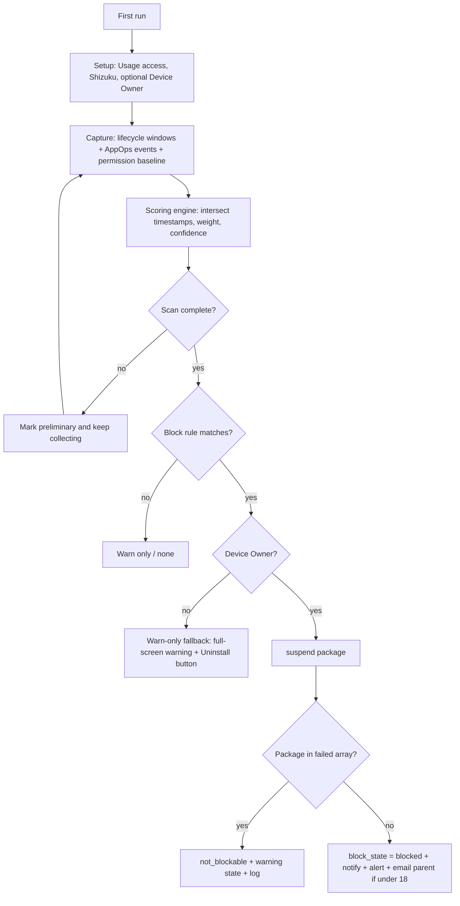

## 2. Setup flow

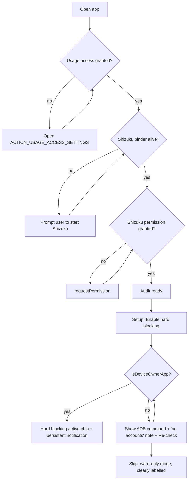

## 3. Scan pipeline

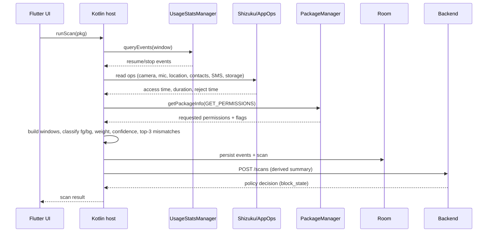

## 4. Block decision

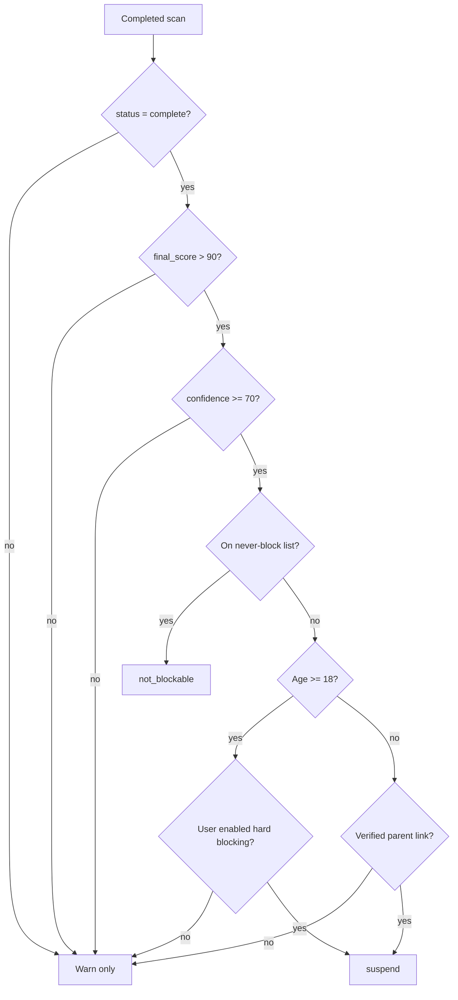

Boundaries: score **90 → not blocked**, **91 → blocked** (only if complete and confidence ≥ 70).

## 5. Block state machine

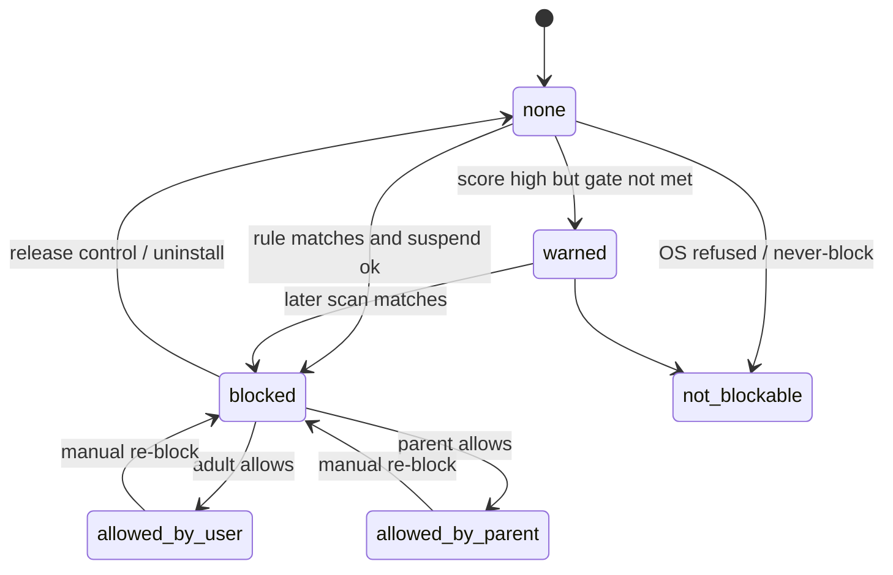

## 6. Under-18: parent allow

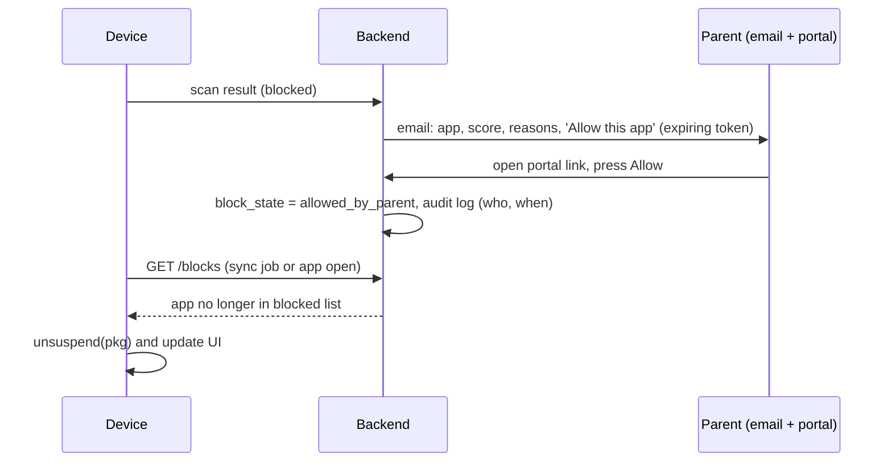

## 7. Adult: allow / re-block

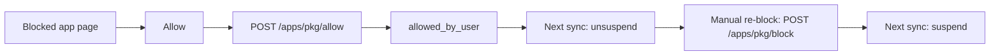

## 8. Block sync loop

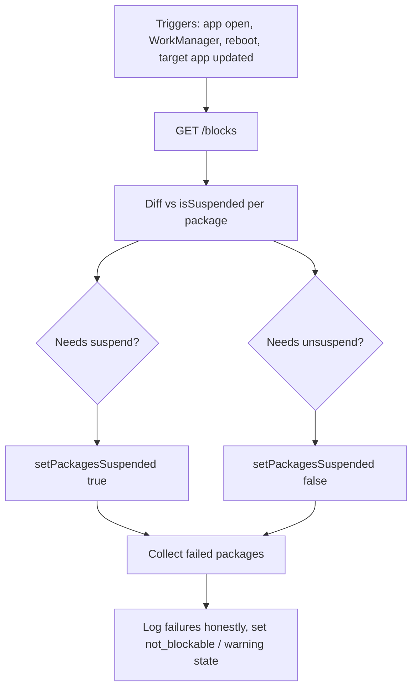

## 9. Suspended-app tap

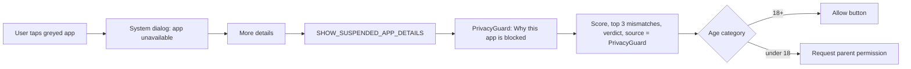

## 10. Release control

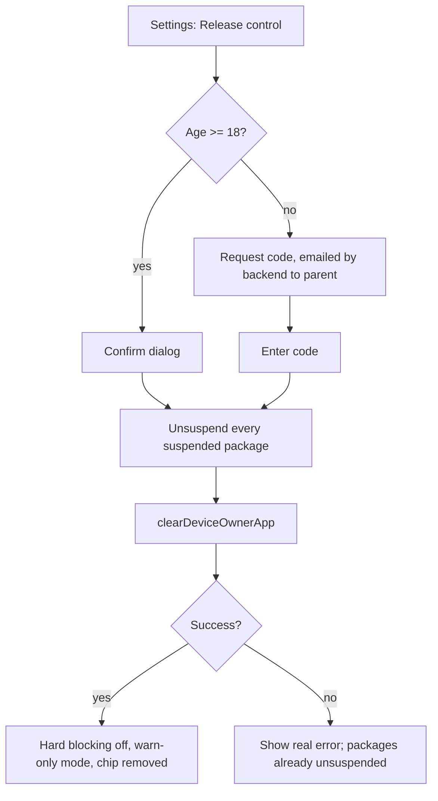

## 11. Background audit

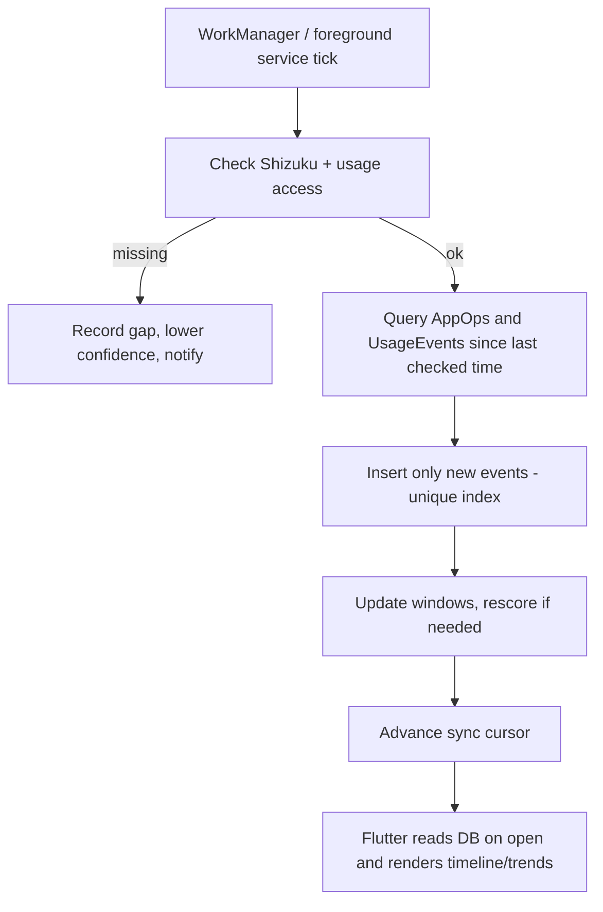

## 12. Warn-only fallback (no Device Owner)

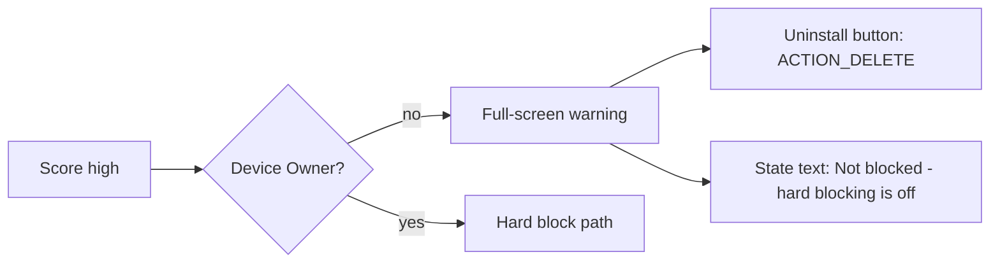
